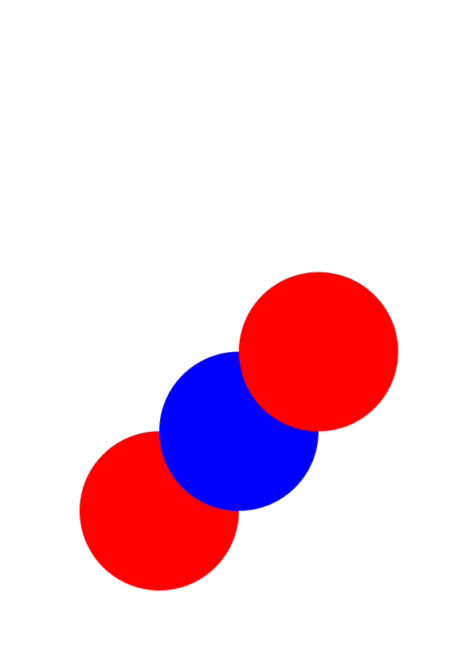
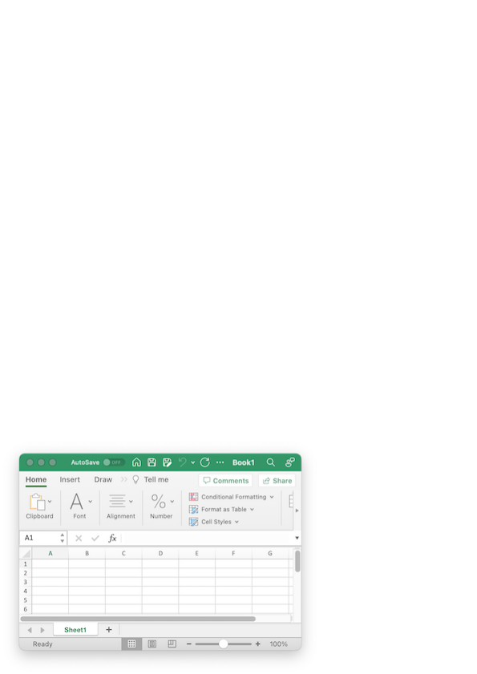

# Drawing on PDFs

## Summary

    cpdf in.pdf [<range>] [-draw-struct-tree] [-underneath] -draw <draw operations> -o out.pdf

    cpdf -text-width <text> [-font ] [-fontsize <fontsize>]

Building and showing paths:

    -rect Draw rectangle
    -to Move to
    -line Add line to path
    -bez Add Bezier curve to path
    -bez23 Add Bezier curve to path
    -bez13 Add Bezier curve to path
    -circle Add circle to path
    -stroke Stroke path
    -fill Fill path
    -filleo Fill path, even odd
    -strokefill Stroke and fill path
    -strokefilleo Stroke and fill path, even odd
    -close Close path

Clipping with paths:

    -clip Clip
    -clipeo Clip, even odd

Path parameters:

    -strokecol Set stroke colour
    -fillcol Set fill colour
    -thick Set stroke thickness
    -cap Set cap
    -join Set join
    -miter Set miter limit
    -dash Set dash pattern

The graphics stack and matrices:

    -push Push graphics stack
    -pop Pop graphics stack
    -matrix Append to graphics matrix
    -mtrans Translate the graphics matrix
    -mrot Rotate the graphics matrix
    -mscale Scale the graphics matrix
    -mshearx Shear the graphics matrix in X
    -msheary Shear the graphics matrix in Y

Re-use with XObjects:

    -xobj-bbox Specify the bounding box for xobjects
    -xobj Begin saving a sequence of graphics operators
    -end-xobj End saving a sequence of graphics operators
    -use Use a saved sequence of graphics operators

Images:

    -draw-jpeg Load a JPEG from file and name it
    -draw-png Load a PNG from file and name it
    -draw-jpeg2000 Load a JPEG2000 from file and name it
    -image Draw an image which has already been loaded

Transparency:

    -fill-opacity Set opacity
    -stroke-opacity Set stroke opacity

Text:

    -bt Begin text
    -et End text
    -text Draw text
    -stext Draw text with %specials
    -para Typeset a paragraph
    -paras Typeset multiple paragraphs
    -leading Set leading
    -charspace Set character spacing
    -wordspace Set word space
    -textscale Set text scale
    -rendermode Set text rendering mode
    -rise Set text rise
    -nl New line

The next page:

    -newpage Move to a fresh page

Structure Information:

    -draw-struct-tree Add structure information
    -tag Begin marked content
    -end-tag End marked content
    -stag Begin structure tree branch
    -end-stag End structure tree branch
    -auto-tags Automatically tag paragraphs and images
    -no-auto-tags Refrain from automatically tagging paragraphs and
    images
    -artifact Begin manual artifact
    -end-artifact End manual artifact
    -no-auto-artifacts Prevent automatic addition of artifacts during
    postprocessing
    -namespace Set the namespace for future branches of the tree
    -eltinfo Set element information
    -end-eltinfo Erase element information
    -rolemap Set role map

## Basics

We can draw on an existing PDF (or a new one created with `-create-pdf` from
the previous chapter) using the `-draw` operation. This provides commands for
drawing vector graphics, simple text and adding images. For example:

`cpdf -create-pdf AND -draw -bt -text Hello -et -o out.pdf`

`cpdf in.pdf -draw -bt -text Hello -et -o out.pdf`

The first example builds a new A4 portrait PDF with one page, and writes Hello
in the default 12pt Times Roman font at the bottom left. The second does the
same, but for every page of an existing PDF.

## Building and showing paths

    -rect "x y w h" Draw rectangle
    -to "x y" Move to
    -line "x y" Add line to path
    -bez "x1 y1 x2 y2 x3 y3" Add Bezier curve to path
    -bez23 "x2 y2 x3 y3" Add Bezier curve to path
    -bez13 "x1 y1 x3 y3" Add Bezier curve to path
    -circle "x y r" Add circle to path
    -stroke Stroke path
    -fill Fill path
    -filleo Fill path, even odd
    -strokefill Stroke and fill path
    -strokefilleo Stroke and fill path, even odd
    -close Close path

To draw line art, we build paths and then stroke or fill them. For
example:

`cpdf -create-pdf AND -draw -to "100 100" -line "400 400" -stroke -line "400 100" -line "100 100" -stroke -o out.pdf`

We use `-to` to start the path at a given coordinate, `-line` to extend the
path with each line, and then `-stroke` to stroke the path.  Coordinates in a
PDF file have the origin $(0, 0)$ at the bottom-left of the page. All units are
in points (1/72 inch). This creates the following PDF:

Alternatively, we may use `-close` to draw the final line back to the
starting point:

`cpdf -create-pdf AND -draw -to "100 100" -line "400 400" -line "400 100" -close -stroke -o out.pdf`

We can have multiple such subpaths in a path, by closing and carrying
on. We can fill our path with `-fill`:

`cpdf -create-pdf AND -draw -to "100 100" -line "400 400" -line "400 100" -close -fill -o out.pdf`

Now we have a filled triangle:

The operations `-filleo`, `-strokefill` and `-strokefilleo` provide
alternative combinations of stroke, fill, and winding rule.

We can save time when drawing rectangles by using the `-rect` operation,
which takes the lower left coordinate, width and height. There is no
need to explicitly close the rectangle.

`cpdf -create-pdf AND -draw -rect "200 300 200 300" -stroke -o out.pdf`

We can build bezier curves using `-bez`, `-bez23` and `-bez13`. The
first adds a bezier path using six coordinates - for the control points
first, and then for the end point (the start point is the current
coordinate):

`cpdf -create-pdf AND -draw -to "100 100" -bez "400 600 600 400 300 300" -stroke -o out.pdf`

Here is the result:

The operation `-bez23` is a shorthand used when the first control point
is equal to the current point. The operation `-bez13` is a shorthand
used when the second control point is equal to the final point.

To avoid calculating the Bezier curves for a circle manually, Cpdf can
generate them automatically when given the center and radius:

`cpdf -create-pdf AND -draw -circle "200 200 100" -stroke -o out.pdf`

## Clipping with paths

    -clip Clip
    -clipeo Clip, even odd

We can use a path to form a clipping region for subsequent content using
`-clip` or `-clipeo`. For example:

`cpdf -create-pdf AND -draw -circle "300 300 100" -clip -circle "300 350 100" -fill -o out.pdf`

Here is the result:

## Path parameters

    -strokecol "g" | "r g b" | "c m y k" | <namedcolour> Set stroke colour
    -fillcol "g" | "r g b" | "c m y k" | <namedcolour> Set fill colour
    -thick <n> Set stroke thickness
    -cap butt | round | square Set cap
    -join miter | round | bevel Set join
    -miter <n> Set miter limit
    -dash <pattern> Set dash pattern

We can set stroke and fill colours for our paths, either as greyscale
(one component), RGB (three components) or CMYK (four components), or by
naming a colour as described in Chapter 8:

`cpdf -create-pdf AND -draw -circle "200 200 100" -thick 20 -strokecol 0.5 -fillcol "0.2 0.7 0.2" -strokefill -o out.pdf`

Here is the result:

We can set line caps and joins with `-cap`, `-join`:

`cpdf -create-pdf AND -draw -to "100 100" -join round -cap round -thick 40 -line "200 200" -line "220 100" -stroke -o out.pdf`

Then we see:

The miter limit (see PDF reference for details) may be set with
`-miter`.

Lines may have dash patterns. A dash pattern consists of one or more
numbers. All save the last form the list of dash lengths and gap
lengths. The last is the phase, which defines how far along the pattern
we start. For example, using a dash pattern of \"30 20 0\" i.e black 30,
white 20, phase 0:

`cpdf -create-pdf AND -draw -to "100 100" -dash "30 20 0" -thick 20 -line "400 300" -stroke -o out.pdf`

Here is the result:

## The graphics stack and matrices

    -push Push graphics stack
    -pop Pop graphics stack
    -matrix "a b c d e f" Append to graphics matrix
    -mtrans "tx ty" Translate the graphics matrix
    -mrot "x y a" Rotate the graphics matrix counterclockwise around (x, y) by angle a in radians
    -mscale "x y sx sy" Scale the graphics matrix around (x, y)
    -mshearx "x y a" Shear the graphics matrix in X around (x, y) by angle a
    -msheary "x y a" Shear the graphics matrix in Y around (x, y) by angle a

PDF maintains a stack of graphics state, which we can manipulate with
`-push` which stores the current state, then modify the state for our
own purposes, and then use `-pop` to restore the previous state. Such
invocations may be nested. Here is a simple example:

`cpdf -create-pdf AND -draw -circle "200 200 100" -fillcol red -fill -push -fillcol blue -circle "300 300 100" -fill -pop -circle "400 400 100" -fill  -o out.pdf`

When we use `-pop` the colour returns to the saved one:

One very common use for a `-push`/`-pop` pair is to isolate the effects
of an operation which modifies the current transformation matrix. These
operations are used to translate, rotate, scale and so on. For example:

`cpdf -create-pdf AND -draw -circle "200 200 100" -stroke -push -mrot "0 0 -0.3" -mscale "0 0 1.5 2" -circle "200 200 100" -stroke -pop -circle "200 200 50" -fill -o out.pdf`

This is the result. See how the graphics transformation is undone when
`-push` is invoked:

This is important because, in the absence of `-push` and `-pop` there
would be no way to reverse the effect of a graphics matrix modification
except to manually calculate its inverse and apply it.

NB: When writing text (see below) the `-font` option is not subject to
`-push` and `-pop`. Text is set the the font most recently chosen on the
command line.

## Re-use with XObjects

    -xobj-bbox "x y w h" Specify the bounding box for xobjects
    -xobj <name> Begin saving a sequence of graphics operators
    -end-xobj End saving a sequence of graphics operators
    -use <name> Use a saved sequence of graphics operators

In our examples, we have sometimes had to write the same operations
multiple times. To avoid this, PDF has a mechanism called an XObject.
This allows us to save a set of operations for re-use in different
contexts, or on different pages. For example, here we store an XObject
which just strokes a circle. We then `-use` it once, and alter the
colour and transformation matrix and `-use` it again.

`cpdf -create-pdf AND -draw -xobj-bbox "0 0 200 200" -xobj A -circle "100 100 50" -stroke -end-xobj -use A -strokecol red -mtrans "20 20" -use A -o out.pdf`

Note that we must specify a bounding box for the XObject with
`-xobj-bbox`. Here is the result:

XObjects may be nested.

## Images

    -draw-jpeg <name>=<filename> Load a JPEG from file and name it
    -draw-png <name>=<filename> Load a PNG from file and name it
    -draw-jpeg2000 <name>=<filename> Load a JPEG2000 from file and name it
    -image <name> Draw an image which has already been loaded

We can include a 24bit non-transparent and non-interlaced PNG, or any
JPEG or JPEG2000 by using `-draw-jpeg[2000]` or `-draw-png` to load it
and assign it a name. We can then use `-image` to use it at any point:

`cpdf -create-pdf AND -draw -draw-png A=sheet.png -mscale "0 0 400 294" -image A -o out.pdf`

Here is the result:

You can see we had to scale by the width and height of the image to draw
it at the size we expect.

## Transparency

    -fill-opacity <n> Set opacity
    -stroke-opacity <n> Set stroke opacity

We can set fill and stroke transparencies, between 0 (fully transparent)
and 1 (fully opaque):

`cpdf -create-pdf AND -draw -fill-opacity 0.5 -circle "250 300 150" -fill -circle "350 300 150" -fill -o out.pdf`

Here is the result:

Notice that we used `-fill` twice, to ensure each circle was in a
different path. If they had been part of the same path, the effect would
be different.

## Text

    -bt Begin text
    -et End text
    -text <text> Draw text
    -stext <text> Draw text with %specials
    -font <fontname> Set font
    -font-size <n> Set font size
    -leading <n> Set leading
    -charspace <n> Set character spacing
    -wordspace <n> Set word space
    -textscale <n> Set text scale
    -rendermode <n> Set text rendering mode
    -rise <n> Set text rise
    -nl New line

We can draw text in a *text section*, which must start with `-bt` and
end with `-et`. For example:

`cpdf -create-pdf AND -draw -mtrans "50 50" -font Helvetica -font-size 144 -bt -text "Hello" -et -o out.pdf`

Here is the result:

If we use `-stext` instead of `-text` the usual special values from
Chapter 8 (with the exception of URL links) may be used:

`cpdf -create-pdf AND -draw -mtrans "50 50" -font-size 144 -bt -stext "Page %Page" -et -o out.pdf`

Now we see:

We can use `-text` multiple times, interspersing operators which change
the text state, such as font and font size:

`cpdf -create-pdf AND -draw -mtrans "10 20" -font-size 72 -bt -text "Different " -font Times-BoldItalic -text "fonts" -font-size 36 -text " and sizes" -et -o out.pdf`

Here is the result:

We can alter the character space, word space, horizontal scaling (100 =
no scaling, less than 100 shrink, more than 100 stretch), and text rise:

`cpdf -create-pdf AND -draw -mtrans "10 20" -font-size 72 -bt -textscale 75 -charspace 5 -wordspace 20 -text "Different " -font Times-BoldItalic -text "fonts" -font-size 36 -rise 40 -text " and sizes" -et -o out.pdf`

Now we see:

Text may appear on multiple lines. We set up the line spacing with
`-leading` then make new lines with `-nl`:

`cpdf -create-pdf AND -draw -mtrans "100 200" -font-size 50 -leading 55 -bt -text "This is" -nl -text "on multiple" -nl -text "lines" -et -o out.pdf`

Now we have:

When composing text, we may need to find the width of a piece of text to
see where to break it, or for right alignment. We can use `-text-width`
for this:

`cpdf -font Times-Roman -font-size 20 -text-width "Hello"`

The result is in points.

We can change the text rendering mode to show outline text or, in this
example, to use text as a clipping region:

`cpdf -create-pdf AND -draw -rendermode 7 -mtrans "100 200" -font-size 50 -leading 55 -bt -text "This is" -nl -text "on multiple" -nl -text "lines" -et -circle "100 0 100" -fill -o out.pdf`

Here is the result:

Here are the text rendering modes:

    0   Fill text (default)                                   
    1   Stroke text                                           
    2   Fill, then stroke text                                
    3   Neither fill nor stroke (invisible)                   
    4   Fill text and add to path for clipping                
    5   Stroke text and add to path for clipping              
    6   Fill, then stroke text and add to path for clipping   
    7   Add text to path for clipping                         

NB: When writing text the `-font` option is not subject to `-push` and
`-pop`. Text is set the the font most recently chosen on the command
line.

NB: To use a TrueType font with `-draw`, the `-load-ttf` must appear
after the `-draw`.

NB: To use `-embed-std14`, put it before `-draw`.

## Paragraphs

We can add a paragraph of text of a given width and justification (Left,
Right, or Center) using the `-para` operation:

`cpdf -create-pdf AND -draw -mtrans "200 400" -font-size 20 -leading 25 -bt -para "L200pt=This is a paragraph of width 100pt, left-justified, containing more than one line..." -et -o out.pdf`

Notice the paragraph specification `L200pt=` for left justified,
200pt-wide at the beginning of the string. Notice also we must give a
value for `-leading`. Here is the result:

Multiple paragraphs with optional indenting may be laid out with
`-paras`:

`cpdf -create-pdf AND -draw -mtrans "200 500" -bt -font-size 20 -leading 25 -indent 20 -paras "L300=This is the first paragraph, which is spread over multiple lines at this width...\nAnd here is the second, also taking more than one line.\nHere is a little one." -et AND -decompress -o out.pdf`

We specify the newlines with `\n`, and the indentation with `-indent`.
Here is the result.

Note that there is no automatic typesetting over multiple pages with
`-paras`.

## The next page

`-newpage` Move to a fresh page

If the drawing range is a single page, and the next page already exists,
the drawing operation `-newpage` operation moves to the next page.
Otherwise, it creates a fresh page of the same dimensions as the last
page of the document, and sets the drawing range to just that page. For
example:

`cpdf -create-pdf AND -draw -bt -text "Page 1" -et -newpage -bt -text "Page 2" -et -o out.pdf`

This will create a two page PDF with "Page 1" written on page one and
"Page 2" written on page two.

## Structure information

A PDF may contain, in addition to its graphical content, a tree of
information concerning the logical organization of the document into
chapters, sections, paragraphs, figures and so on. When used with a
standard set of pre-defined data types, this is known as Tagged PDF.
Some PDF subformats, such as PDF/UA, mandate - amongst other things -
the full tagging of the file.

When drawing on a fresh file, Cpdf can add such structure information.
Partly this can happen automatically, partly it is for the user to add
the tags. When drawing on an existing file, the new drawing is marked as
an artifact.

To enable the generation of structure information, we add
`-draw-struct-tree` to our command. NB It must precede `-draw` on the
command line.

`cpdf -create-pdf AND -draw-struct-tree -draw -bt -text "Hello, World" -et -o out.pdf`

Structure information in a PDF is in the form of a tree. We can now show
the structure tree, and see that our paragraph on page one has been
automatically tagged by Cpdf:

    $cpdf -print-struct-tree out.pdf
    StructTreeRoot
        P (1)

To prevent such automatic tagging, relying only on manual tags, use
`-no-auto-tags`. The effect may be reversed at any point with
`-auto-tags`. Unless told otherwise, Cpdf auto-tags text added using
`-text`, `-stext` and `-paras` with tag P, and images with tag Figure.

There are two types of tag we can add manually. One kind is used to tag
individual pieces of content. We do this with a `-tag`/`-end-tag` pair.
Note that nesting is not permitted here. For example, let us tag a
heading:

`cpdf -create-pdf AND -draw-struct-tree -draw -mtrans "50 700" -font-size 40 -no-auto-tags -tag H1 -bt -text "This is the heading" -et -end-tag -auto-tags -mtrans "0 -100" -font-size 20 -leading 25 -bt -paras "L200pt=This is the first paragraph, which spreads over more than one line\nHere is the second, which also has multiple lines..." -et -o out.pdf`

We turned off auto-tagging with `-no-auto-tag`, then used `-tag H1` and
`-end-tag` to tag the heading. Then we turned auto-tagging back on with
`-auto-tag`. Here is the result, visually:

And here is the structure tree:

    StructTreeRoot
        H1 (1)
        P (1)
        P (1)

Content tagging is flat - every part of the content of a page is part of
only one `-tag`. The logical structure of a document, however, is a tree
structure - sections contain paragraphs, and so on. To build the
logical structure tree, we add structure tags using `-stag` /
`-end-stag` pairs which, of course, may be nested. For example, let's
put our H1, and P sections in a Section structure tag:

`cpdf -create-pdf AND -draw-struct-tree -draw -mtrans "50 700" -font-size 40 -no-auto-tags -stag Section -tag H1 -bt -text "This is the heading" -et -end-tag -auto-tags -mtrans "0 -100" -font-size 20 -leading 25 -bt -paras "L200pt=This is the first paragraph, which spreads over more than one line\nHere is the second, which also has multiple lines..." -et -end-stag -o out.pdf`

Here is the structure tree:

    StructTreeRoot
       Section (1)
            H1 (1)
            P (1)
            P (1)

Some PDF standards require that everything not marked as content (e.g
paragraph, figure) etc. is marked as a an artifact. For example, a
background image which is the same on every page, or a page border. This
tells PDF processors that it is not logical content.

By default, Cpdf with `-draw-struct-tree` will mark anything not
automatically or manually tagged as content as an artifact. Should you
wish to disable this, you may use `-no-auto-artifacts`. Whether or not
you use `-no-auto-artifacts`, you may use `-artifact` / `end-artifact`
pairs to mark artifacts manually. For example:

`cpdf -create-pdf AND -draw-struct-tree -draw -no-auto-artifacts -artifact -mtrans "50 700" -end-artifact -bt -text "Hello" -et -o out.pdf`

Here we manually tagged the `-mtrans` as being an artifact. The text
section was automatically tagged as a paragraph, and so all content has
been tagged or marked as an artifact.

Some tags require a namespace other than the default. You can set the
namespace with `-namespace`, which affects all future tags until reset.
Two namespace abbreviations are available: `PDF` for the default
`http://iso.org/pdf/ssn` namespace and `PDF2` for the PDF 2.0 namespace
`http://iso.org/pdf2/ssn`.

Extra information may be added to structure tree nodes with `-eltinfo` /
`-end-eltinfo`. For example, to set the alternative description for an
image, we might write (in JSON format, or prefixing with `PDF` in PDF
format) `-eltinfo "Alt=PDF(A large horse)" -image A -end-eltinfo`.
Multiple items may be set at once, for example Alt, ActualText, Lang
etc.

A role map, which maps non-standard structure types to standard ones,
may be set with `-rolemap`. For example `-rolemap "/S1/H1/S2/H2"` would
map the S1 structure type to the standard type H1 and so on.

To build a fresh PDF/UA or PDF/UA-2 file for use with `-draw` use
`-create-pdf-ua-1` or `-create-pdf-ua-2` from chapter FIXME.
